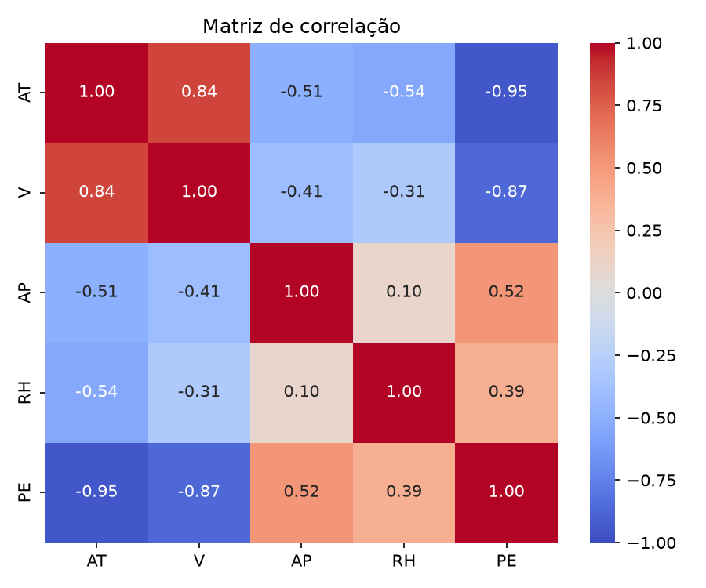
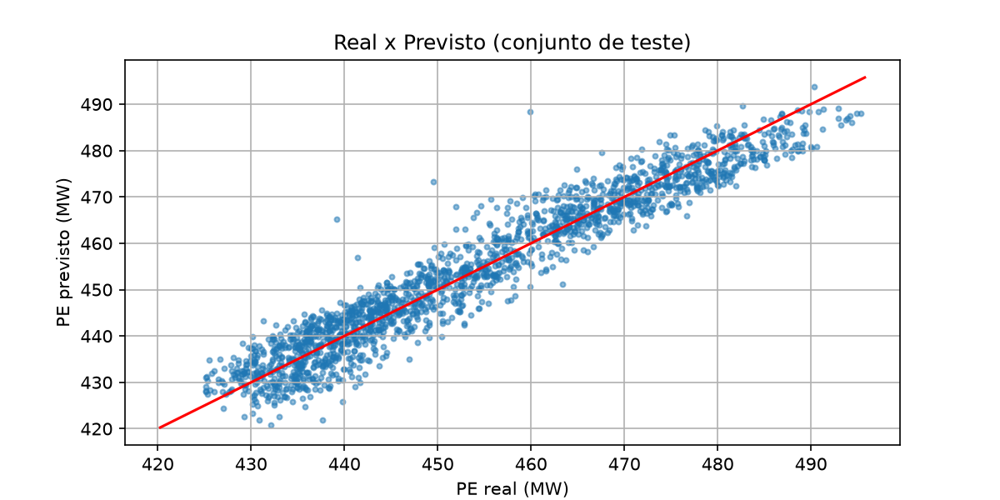
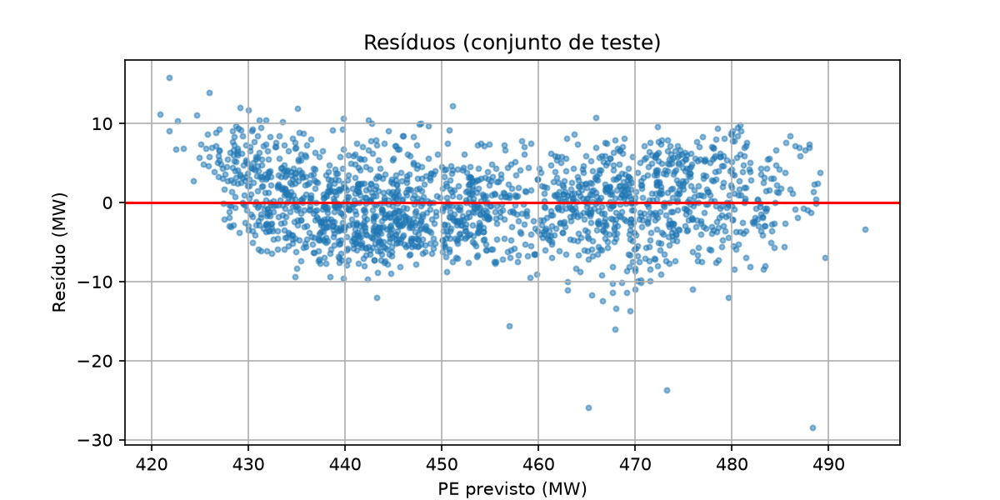

# Problema 1 - Regressão Linear para Previsão de Produção de Energia (CCPP)

Código completo e executado: [`src/problema1.ipynb`](src/problema1.ipynb)

## 1. Problema e dados

Prever a potência elétrica de saída PE, em MW de uma usina de ciclo combinado a partir de quatro
sensores ambientais: temperatura AT, vácuo de escape V, pressão ambiente AP e umidade
relativa RH. Dataset: UCI Combined Cycle Power Plant, com 9.568 amostras ([data/ccpp.csv](data/ccpp.csv)).

## 2. Pré-processamento

- Valores ausentes: não há nenhum verificado com df.isna().sum(), então não foi preciso imputar.
- Divisão: 80% treino 7.654 amostras e 20% teste 1.914 amostras, com random_state=42.
- Padronização (z-score):StandardScaler ajustado só no treino e depois aplicado ao teste, para
  não vazar informação do conjunto de teste.

## 3. Tarefa 1 - Correlação das variáveis com PE

| Variável | Correlação com PE |
|---|---|
| AT | -0,948 |
| V | -0,870 |
| AP | +0,518 |
| RH | +0,390 |

Resposta: AT e V são as que mais influenciam a produção, e as duas de forma negativa: dias mais
quentes e maior vácuo de escape reduzem a energia gerada. AP e RH têm influência moderada e positiva.

## 4. Tarefa 2 - Correlação entre as variáveis independentes

|  | AT | V | AP | RH |
|---|---|---|---|---|
| AT | 1,000 | 0,844 | -0,508 | -0,543 |
| V | 0,844 | 1,000 | -0,414 | -0,312 |
| AP | -0,508 | -0,414 | 1,000 | 0,100 |
| RH | -0,543 | -0,312 | 0,100 | 1,000 |

Resposta: sim. AT e V têm correlação forte 0,84, o que indica multicolinearidade: as duas
variáveis carregam quase a mesma informação. Na prática, os coeficientes individuais de AT e V ficam
menos confiáveis para interpretar, mas a qualidade da previsão não é prejudicada.

## 5. Tarefa 3 - Modelo de regressão linear múltipla

Modelo: PE = θ0 + θ1·AT + θ2·V + θ3·AP + θ4·RH, treinado com LinearRegression do scikit-learn sobre as
variáveis padronizadas.

| Parâmetro | Valor |
|---|---|
| Intercepto (θ0) | 454,43 |
| AT | -14,76 |
| V | -2,95 |
| AP | +0,37 |
| RH | -2,31 |

Como as variáveis estão padronizadas, os coeficientes são comparáveis: AT é a que mais pesa na previsão.

## 6. Tarefa 4 - Avaliação (conjunto de teste)

| Conjunto | R² | RMSE (MW) | MAE (MW) |
|---|---|---|---|
| Treino | 0,9283 | 4,57 | 3,63 |
| Teste | 0,9301 | 4,50 | 3,60 |

O modelo é adequado para prever a produção de energia? Sim, com ressalvas. Explica cerca de 93% da variação de PE. O erro típico é de ~4,5 MW (RMSE) e ~3,6 MW (MAE), pequeno diante do desvio padrão de PE 17 MW e da faixa de valores 420 a 496 MW. Treino e teste têm métricas praticamente iguais, então não há overfitting e o modelo generaliza bem. Porem o gráfico de resíduos mostra uma leve curvatura e erros um pouco maiores nas pontas e a relação não é perfeitamente linear, e um modelo mais flexível poderia melhorar um pouco o resultado.

