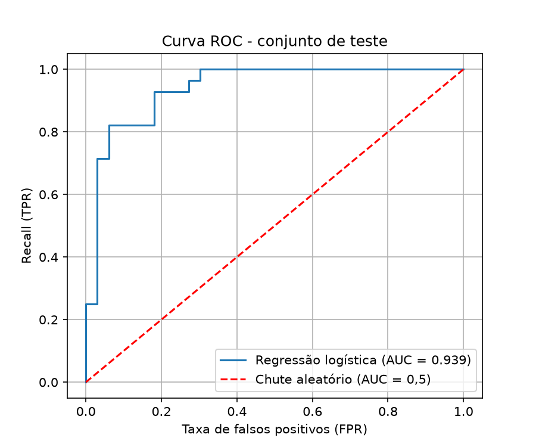

# Problema 2 - Regressão Logística para Previsão de Doenças Cardíacas

Código completo e executado: [`src/problema2.ipynb`](src/problema2.ipynb)

## 1. Problema e dados

Prever a presença de doença cardíaca a partir de 13 variáveis clínicas, usando regressão logística. Dataset:
UCI Heart Disease - Cleveland, com 303 pacientes ([`data/heart_cleveland.csv`](data/heart_cleveland.csv)).

## 2. Pré-processamento

- Valores ausentes:6 no total (4 em ca e 2 em thal, marcados com ? no arquivo original). Como são
  variáveis categóricas, foram preenchidos com a moda calculada no treino (ca = 0, thal = 3).
- Binarização do alvo: num = 0 → classe 0 sem doença; num = 1 a 4 → classe 1 com doença.
  Resultado: 164 sem doença e 139 com doença (conjunto razoavelmente balanceado).
- Divisão: 80% treino (242) e 20% teste (61), estratificada e com random_state=42.
- One-hot encoding em cp, restecg, slope e thal, que são categorias sem ordem (13 → 22 features).
- Padronização (z-score): StandardScaler ajustado só no treino e aplicado ao teste.

## 3. Treinamento e convergência

Modelo: LogisticRegression(solver='liblinear', random_state=42, max_iter=1000).

O modelo convergiu em 6 iterações (atributo n_iter_), muito abaixo do limite de 1000. A padronização dos
dados facilita a convergência do otimizador.

Variáveis com maior peso (coeficientes sobre dados padronizados):

| Aumentam a chance de doença | Coef. | Diminuem a chance de doença | Coef. |
|---|---|---|---|
| ca (artérias obstruídas) | +1,17 | thalach (freq. cardíaca máx.) | -0,34 |
| sex (masculino) | +0,75 | cp_3 (dor não anginosa) | -0,33 |
| cp_4 (assintomático) | +0,43 | thal_3 (tálio normal) | -0,32 |
| thal_7 (defeito reversível) | +0,38 | slope_1 (ST ascendente) | -0,30 |

## 4.Avaliação no conjunto de teste

Matriz de confusão (linhas = real, colunas = previsto):

|  | Previsto: sem doença | Previsto: com doença |
|---|---|---|
| Real: sem doença | 27 (VN) | 6 (FP) |
| Real: com doença | 4 (FN) | 24 (VP) |

| Métrica | Valor |
|---|---|
| Acurácia | 0,836 |
| Precisão | 0,800 |
| Recall | 0,857 |
| F1-score | 0,828 |
| AUC-ROC | 0,939 |

## 5. Conclusão

O modelo acerta 84% dos pacientes e identifica 86% dos doentes. A AUC de 0,94 indica ótima capacidade de separar as duas classes. Em diagnóstico médico, o erro mais grave é o falso negativo (doente classificado como saudável): foram 4 em 28 doentes. Para reduzi-lo, seria possível diminuir o limiar de decisão (padrão 0,5), aumentando o recall em troca de mais falsos positivos. As variáveis mais relevantes fazem sentido clínico: mais artérias obstruídas, sexo masculino, dor assintomática e defeito reversível no tálio aumentam o risco; frequência cardíaca máxima alta diminui. Ressalva: com apenas 61 pacientes no teste, cada paciente altera a acurácia em ~1,6 ponto percentual e outra divisão treino/teste pode gerar valores um pouco diferentes.

