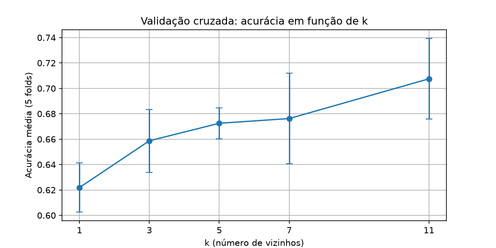
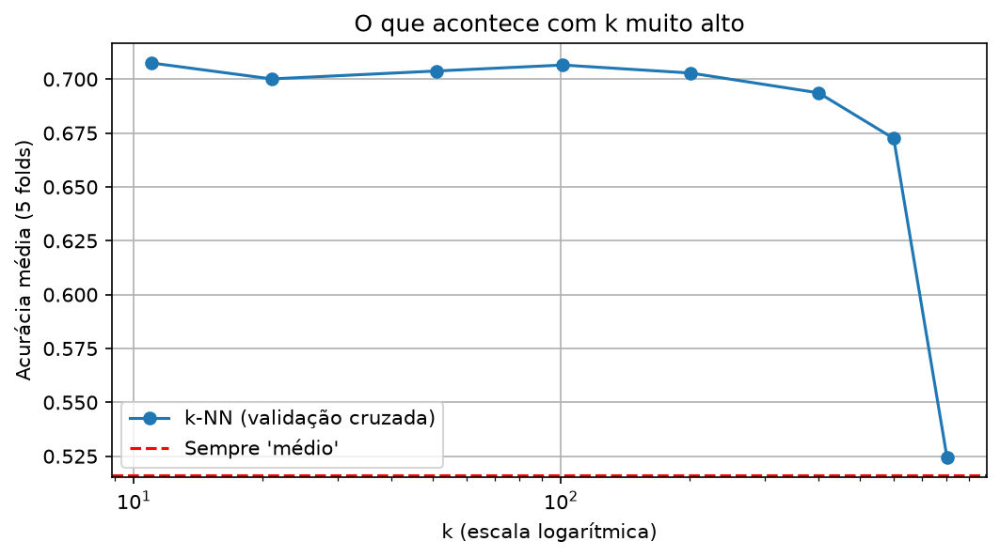
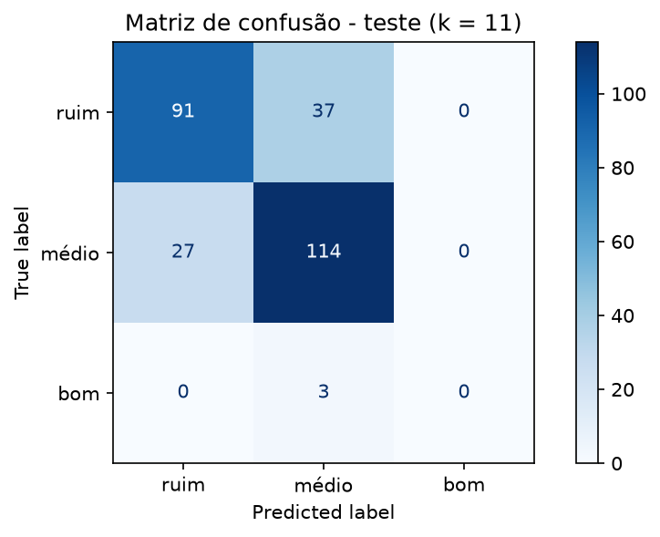

# Problema 3 - Classificação de Qualidade de Vinhos Utilizando k-NN

Código completo e executado: [`src/problema3.ipynb`](src/problema3.ipynb)

## 1. Problema e dados

Classificar vinhos tintos em três categorias de qualidade a partir de 11 atributos físico-químicos, usando o
k-NN. Dataset: UCI Wine Quality, arquivo `winequality-red.csv`, com 1.599 vinhos
([`data/winequality-red.csv`](data/winequality-red.csv)).

## 2. Tarefa 1 - Preparação dos dados

- Duplicatas removidas: o arquivo tem 240 linhas repetidas. Elas foram removidas antes da divisão, restando
  1.359 vinhos. No k-NN, uma cópia no treino e outra no teste fazem o vizinho mais próximo ser o próprio vinho
  (distância zero), o que infla a acurácia. Antes da remoção, 63 dos 320 vinhos do teste tinham cópia idêntica no
  treino, e isso fazia k = 1 parecer o melhor valor de forma enganosa.
- Recodificação da qualidade: nota ≤ 5 → ruim; 6–7 → médio; ≥ 8 → bom.

  | Classe | Vinhos |
  |---|---|
  | médio | 702 |
  | ruim | 640 |
  | bom | 17 |

  A classe bom tem apenas 1,3% dos dados: o conjunto é desbalanceado.
- Normalização Min-Max (atributos entre 0 e 1), ajustada só no treino.

Por que normalizei? O k-NN decide pela distância euclidiana entre os vinhos.
Os atributos têm escalas muito diferentes: `total sulfur dioxide` vai de 6 a 289, enquanto `density` varia de
0,990 a 1,004. Sem normalizar, as variáveis com valores grandes dominariam a distância e as demais seriam
praticamente ignoradas. Com a normalização, todas contribuem de forma equilibrada.

## 3. Tarefa 2 - Divisão treino/teste

80% treino (1.087 vinhos) e 20% teste (272 vinhos), estratificada (`stratify=y`) e com `random_state=42`. As
proporções das classes ficaram praticamente iguais nos dois conjuntos (ruim 47,1% / 47,1%; médio 51,6% / 51,8%;
bom 1,3% / 1,1%). Sem a estratificação, a classe "bom" poderia nem aparecer no teste.

## 4. Tarefa 3 - Escolha do k (validação cruzada de 5 folds no treino)

| k | Acurácia média | Desvio padrão |
|---|---|---|
| 1 | 0,622 | 0,019 |
| 3 | 0,659 | 0,025 |
| 5 | 0,673 | 0,012 |
| 7 | 0,676 | 0,036 |
| **11** | **0,708** | 0,032 |

Melhor valor: k = 11.

- k muito baixo: o modelo depende de um único vizinho, "decora" o treino e é sensível a ruído e outliers →
  overfitting (alta variância). Por isso k = 1 teve o pior desempenho.
- k muito alto: a votação envolve vizinhos distantes e de outras classes; a fronteira fica suave demais e o
  modelo tende a prever sempre a classe majoritária → underfitting (alto viés). Para comprovar, foram testados
  também valores bem maiores que os do enunciado:

  | k | 11 | 21 | 51 | 101 | 201 | 401 | 601 | 801 |
  |---|---|---|---|---|---|---|---|---|
  | Acurácia média | **0,708** | 0,700 | 0,704 | 0,707 | 0,703 | 0,694 | 0,673 | 0,524 |

  

  De k = 11 até k ≈ 200 a acurácia fica estável (~0,70); depois ela cai até 0,524 com k = 801, quase igual
  aos 51,6% de quem responde sempre "médio" (a classe majoritária). Nenhum valor maior superou k = 11.

## 5. Tarefa 4 - Avaliação no conjunto de teste

Matriz de confusão (linhas = real, colunas = previsto):

|  | prev: ruim | prev: médio | prev: bom |
|---|---|---|---|
| **real: ruim** | 91 | 37 | 0 |
| **real: médio** | 27 | 114 | 0 |
| **real: bom** | 0 | 3 | 0 |

| Classe | Precisão | Recall | F1-score | Vinhos no teste |
|---|---|---|---|---|
| ruim | 0,771 | 0,711 | 0,740 | 128 |
| médio | 0,740 | 0,809 | 0,773 | 141 |
| bom | 0,000 | 0,000 | 0,000 | 3 |

Acurácia: 0,754.

O modelo erra com mais frequência entre ruim e médio: 37 ruins previstos como médios e 27 médios previstos como ruins (64 dos 67 erros). São classes vizinhas na escala (notas 5 e 6), com composições químicas parecidas, então seus vinhos ficam próximos no espaço de atributos.

A classe bom nunca foi prevista: os 3 vinhos bons do teste foram classificados como médios. Com só 17 vinhos
bons no total, é raro que a maioria dos 11 vizinhos de um vinho seja bom. A acurácia de 75% esconde esse
problema; para melhorar a classe minoritária seria preciso tratar o desbalanceamento (por exemplo, com SMOTE ou
com votação ponderada pela distância).

