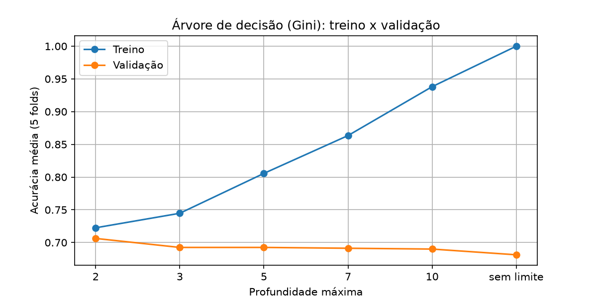
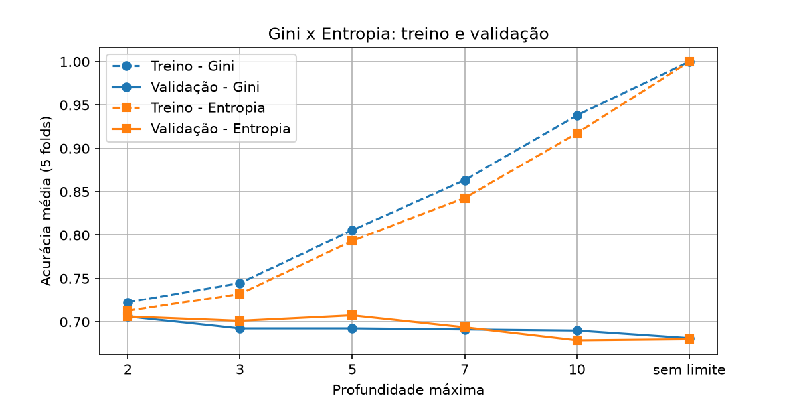
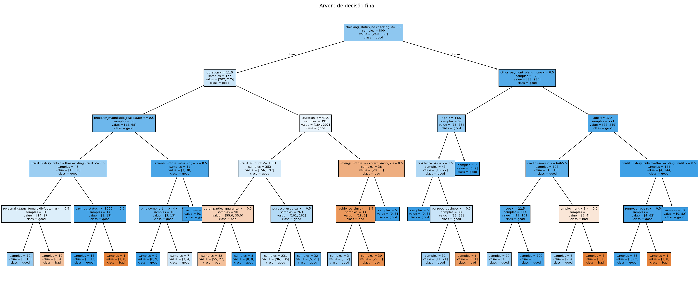
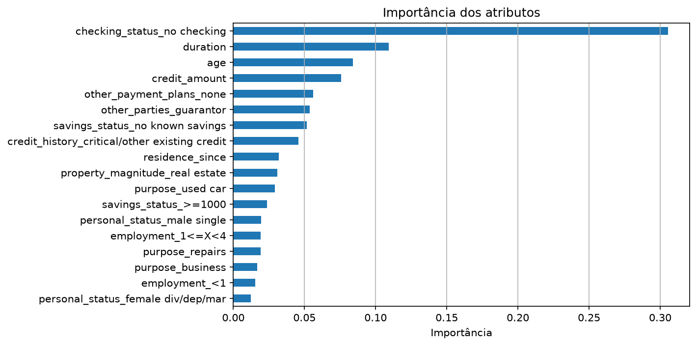
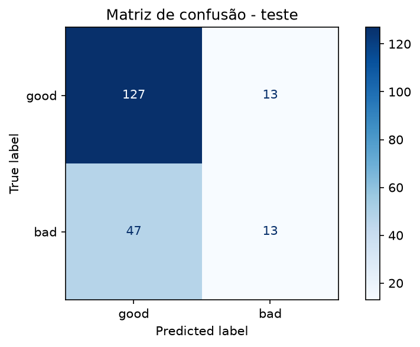

# Problema 4 - Classificação de Risco de Crédito Utilizando Árvores de Decisão

Código completo e executado: [`src/problema4.ipynb`](src/problema4.ipynb)

## 1. Problema e dados

Classificar solicitantes de crédito em bom pagador (`good`) ou mau pagador (`bad`) com uma árvore de decisão.
Dataset: UCI Statlog (German Credit Data), 1.000 solicitações. Foi usada a versão com rótulos legíveis
(`credit-g` do OpenML), indicada no enunciado como alternativa ao `german.data`
([`data/credit_g.csv`](data/credit_g.csv)). Conferi que os dados são os mesmos do arquivo da UCI: duração, valor,
idade e classe são idênticos nas 1.000 linhas. Sem valores ausentes e sem duplicatas.

## 2. Tarefa 1 - Preparação dos dados

- Numéricos (7): `duration`, `credit_amount`, `installment_commitment`, `residence_since`, `age`,
  `existing_credits`, `num_dependents`.
- Categóricos (13): `checking_status`, `credit_history`, `purpose`, `savings_status`, `employment`,
  `personal_status`, `other_parties`, `property_magnitude`, `other_payment_plans`, `housing`, `job`,
  `own_telephone`, `foreign_worker`.
- Codificação: é necessária, porque o `DecisionTreeClassifier` do scikit-learn só aceita números. Usei
  one-hot encoding (20 → 61 atributos). Como ele não aprende nada dos dados, pode ser feito antes da divisão
  sem vazamento.
- Balanceamento: 700 `good` (70%) x 300 `bad` (30%). Impacto na acurácia: um modelo que respondesse
  sempre "good" já teria 70% de acurácia sem aprender nada. Então a acurácia precisa ser comparada com essa linha
  de base, e o mais importante é o recall da classe `bad`.

## 3. Tarefa 2 - Por que a normalização não é necessária

A árvore faz perguntas do tipo "atributo ≤ limiar?", um atributo por vez, e só a ordem dos valores importa.
Mudar a escala de um atributo (por exemplo, converter o valor para outra moeda) muda o número do limiar, mas separa
exatamente as mesmas amostras. A árvore resultante é a mesma. Diferente do k-NN, não há cálculo de distância entre
atributos de escalas diferentes.

## 4. Tarefa 3 - Divisão treino/teste

80% treino (800) e 20% teste (200), **estratificada** e com `random_state=42`. As duas partes ficaram com
exatamente 70% `good` e 30% `bad`.

## 5. Tarefa 4 - Profundidade máxima (validação cruzada de 5 folds)

| Profundidade | Gini: treino | Gini: validação | Entropia: treino | Entropia: validação |
|---|---|---|---|---|
| 2 | 0,723 | **0,706** | 0,713 | 0,706 |
| 3 | 0,745 | 0,693 | 0,732 | 0,701 |
| 5 | 0,806 | 0,693 | 0,793 | **0,708** |
| 7 | 0,863 | 0,691 | 0,843 | 0,694 |
| 10 | 0,938 | 0,690 | 0,918 | 0,679 |
| sem limite | 1,000 | 0,681 | 1,000 | 0,680 |

- Profundidade muito baixa → underfitting: a árvore é simples demais; treino e validação ficam baixos e
  próximos dos 70% do "sempre good".
- Profundidade muito alta → overfitting: sem limite, o treino chega a 100% e a validação cai para 68%.
  A árvore decorou o treino, inclusive o ruído.
- Gini x entropia: o melhor Gini foi a profundidade 2 (0,7062) e a melhor entropia foi a profundidade 5 (0,7075).
  A diferença (0,001) é bem menor que o desvio entre os folds (~0,02): não há diferença relevante entre os
  critérios.
- Escolha final: entropia com profundidade 5. Ela teve a maior acurácia de validação. Além disso, a árvore
  Gini de profundidade 2 é degenerada: as 4 folhas preveem "good", e ela prevê "good" para os 800 clientes do
  treino. Ou seja, nunca identifica um mau pagador.

## 6. Tarefa 5 - Interpretação do modelo

A árvore final tem 25 folhas.

**Três atributos mais determinantes:**

1. checking_status (situação da conta corrente), em especial não possui conta no checking:
   importância 0,306. É a pergunta da raiz.
2. duration (duração do empréstimo): 0,109.
3. age (idade): 0,084.

**Regras do caminho até a folha com mais maus pagadores** (96 `bad` x 135 `good`, 231 clientes no treino):

> **SE** o cliente **possui conta corrente**
> **E** a duração do empréstimo é de **12 a 47 meses**
> **E** o valor solicitado é **maior que 1.381,50 marcos**
> **E** a finalidade **não é carro usado**
> **ENTÃO** a árvore prevê **"good"**.

Ela tem o maior número absoluto de maus pagadores porque é a maior folha da árvore, mas a maioria ali (58%) é de bons pagadores, então a previsão é "good". Isso mostra que a árvore não consegue separar bem os clientes desse grupo grande.

Para comparação, a folha que prevê "bad" com mais maus pagadores (55 `bad` x 27 `good`):

> Se o cliente possui conta corrente e a duração é de 12 a 47 meses e o valor solicitado é no máximo 1.381,50 marcos e não há fiador então a árvore prevê "bad".

## 7. Tarefa 6 - Avaliação no conjunto de teste

| Modelo (entropia, prof. 5) | Acurácia | Precisão `bad` | Recall `bad` | Maus aprovados | Bons recusados |
|---|---|---|---|---|---|
| Sem ajuste | 0,700 | 0,500 | 0,217 | **47** | 13 |
| `class_weight="balanced"` | 0,615 | 0,429 | **0,850** | 9 | 68 |

Qual erro é mais frequente? Classificar um mau pagador como bom: 47 dos 60 maus pagadores do teste foram
aprovados (recall de bad = 0,217). A acurácia de 0,70 é igual à do "sempre good".

Por que é o mais grave? Porque significa conceder crédito a quem não vai pagar, o que gera prejuízo
direto. Recusar um bom pagador gera apenas perda de receita. A documentação do dataset atribui custo 5 vezes maior a esse erro.

Que ajuste eu faria? Treinar com class_weight="balanced", que dá mais peso aos erros na classe minoritária. Os maus pagadores aprovados caíram de 47 para 9 e o recall de bad subiu para 0,85. O preço
foi recusar mais bons pagadores (13 → 68) e a acurácia cair para 0,615. Como aprovar um mau pagador é o erro mais caro, a troca compensa. Outras opções seriam pesos ainda maiores para bad, seguindo o custo 5, ou mudar o limiar de decisão.

