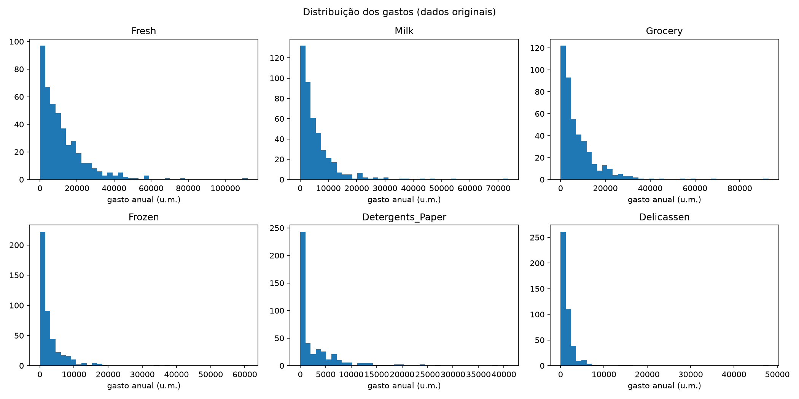
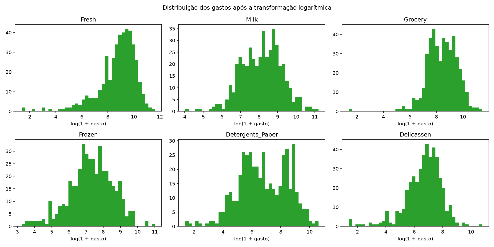
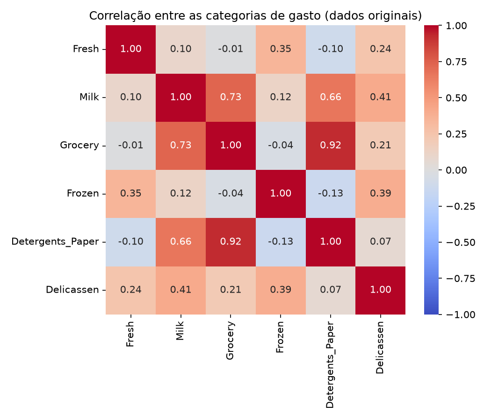
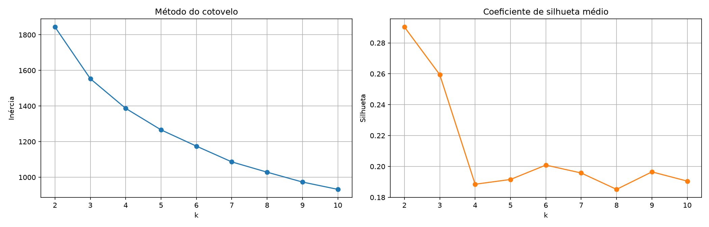
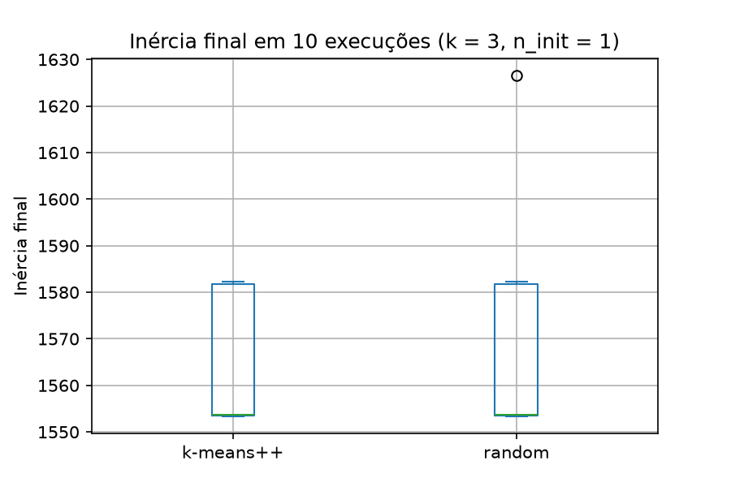
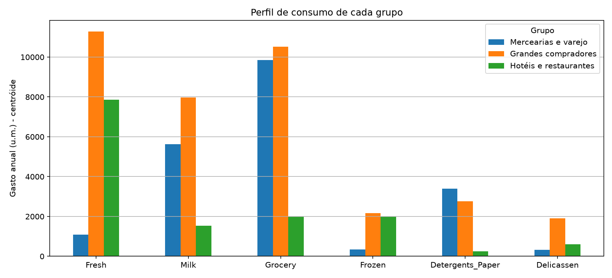
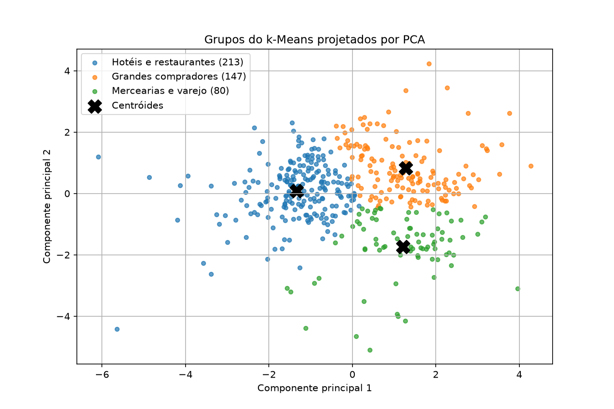

# Problema 5 - Segmentação de Clientes Utilizando k-Means

Código completo e executado: [`src/problema5.ipynb`](src/problema5.ipynb)

## 1. Problema e dados

Identificar perfis de consumo dos clientes de um distribuidor atacadista com o k-Means (aprendizado não
supervisionado). Dataset: UCI Wholesale Customers, com 440 clientes e gastos anuais em seis categorias
([`data/wholesale_customers.csv`](data/wholesale_customers.csv)). Sem valores ausentes. `Channel` (1 = Horeca,
298 clientes; 2 = Retail, 142) e `Region` (1 = Lisboa, 77; 2 = Porto, 47; 3 = outras, 316) não foram usados
no agrupamento, apenas na validação externa.

## 2. Tarefa 1 - Preparação dos dados

| Categoria | Média | Mediana | Desvio padrão | Mínimo | Máximo |
|---|---|---|---|---|---|
| Fresh | 12.000 | 8.504 | 12.647 | 3 | 112.151 |
| Milk | 5.796 | 3.627 | 7.380 | 55 | 73.498 |
| Grocery | 7.951 | 4.756 | 9.503 | 3 | 92.780 |
| Frozen | 3.072 | 1.526 | 4.855 | 25 | 60.869 |
| Detergents_Paper | 2.881 | 816 | 4.768 | 3 | 40.827 |
| Delicassen | 1.525 | 966 | 2.820 | 3 | 47.943 |

Em todas as categorias a média é bem maior que a mediana e os máximos ficam muito acima do restante: as
distribuições são fortemente assimétricas à direita.

(a) Por que a transformação logarítmica `x' = log(1 + x)`? O log comprime muito mais os valores grandes que os
pequenos (um gasto 100 vezes maior vira só ~4,6 unidades a mais). Isso torna as distribuições mais simétricas e
aproxima os outliers (clientes de gasto muito alto) dos demais, evitando que eles puxem sozinhos os centróides, que
são médias e por isso sensíveis a valores extremos.

(b) Por que a padronização (z-score) é determinante para o k-Means? O k-Means atribui cada cliente ao centróide
mais próximo pela distância euclidiana, que soma as diferenças ao quadrado de todos os atributos. Uma categoria
com valores maiores dominaria a distância e os grupos seriam formados quase só por ela. Com o z-score (média 0,
desvio 1), as seis categorias pesam igualmente.

Correlação: o par Grocery x Detergents_Paper tem correlação de 0,925 (0,797 após o log), a maior da
matriz. São os produtos típicos de revenda no varejo: quem compra muito um, compra muito o outro. As duas
variáveis carregam praticamente a mesma informação, um "eixo varejo".

## 3. Tarefa 2 - Ausência de divisão treino/teste

No aprendizado supervisionado o teste serve para estimar o erro de generalização: medir o acerto em rótulos
que o modelo não viu. No agrupamento não existe rótulo, logo não existe acerto a medir; o objetivo é
descrever a estrutura dos dados disponíveis, e por isso usamos todos os 440 clientes.

A dificuldade central da validação é afirmar que uma partição é "boa" sem gabarito: os mesmos dados admitem
vários agrupamentos razoáveis. Recorre-se a critérios indiretos: internos (inércia, silhueta), externos
(informação não usada pelo algoritmo, como `Channel` e `Region`) e a interpretabilidade dos grupos.

## 4. Tarefa 3 - Escolha do número de grupos

| k | 2 | 3 | 4 | 5 | 6 | 7 | 8 | 9 | 10 |
|---|---|---|---|---|---|---|---|---|---|
| Inércia | 1844,1 | 1553,4 | 1386,9 | 1266,1 | 1174,8 | 1086,4 | 1028,5 | 973,1 | 932,0 |
| Silhueta | **0,290** | **0,259** | 0,189 | 0,192 | 0,201 | 0,196 | 0,185 | 0,197 | 0,191 |

Escolha: k = 3.

- Cotovelo: a maior queda de inércia é de k = 2 para k = 3 (−290,6); depois as quedas diminuem (−166,6,
  −120,7, −91,4...).
- Silhueta: máxima em k = 2 (0,290), com k = 3 logo atrás (0,259); a partir de k = 4 cai para ~0,19.
- Interpretabilidade comercial: com k = 2 os grupos quase repetem a divisão Horeca x Varejo, que a empresa já
  conhece. Com k = 3 surge o perfil de grandes compradores, que pede uma ação comercial própria.

Por que a inércia decresce monotonicamente com k? Um centróide a mais nunca afasta um cliente do centróide mais
próximo, e em geral aproxima vários. Logo, a soma das distâncias ao quadrado sempre diminui, e a inércia não pode
ser usada sozinha: ela sempre "preferiria" o maior k.

Caso limite (k = 440): cada cliente vira seu próprio grupo, o centróide coincide com ele e a inércia é zero.
A partição é "perfeita" pela inércia e totalmente inútil.

## 5. Tarefa 4 - Inicialização e convergência

Dez execuções com `n_init=1` e sementes de 0 a 9 (k = 3):

| | `init='random'` | `init='k-means++'` |
|---|---|---|
| Menor inércia | 1553,39 | 1553,34 |
| Maior inércia | **1626,55** | 1582,23 |
| Média | 1569,21 | 1564,79 |
| Desvio padrão | **24,11** | 14,55 |

As duas inicializações chegaram ao melhor valor (~1553) em 6 das 10 execuções, mas com `random` os resultados foram
mais dispersos e uma execução parou num mínimo local bem pior (1626,55).

Problema que o k-means++ mitiga: o k-Means converge para um mínimo local que depende dos centróides iniciais.
Sorteados ao acaso, eles podem cair próximos entre si (dois no mesmo grupo natural), levando a uma solução ruim. O
k-means++ escolhe cada novo centróide com probabilidade proporcional ao quadrado da distância ao centróide mais
próximo já escolhido, espalhando os centróides iniciais. Ele reduz, mas não elimina, o risco; por isso o modelo final
usa `n_init=10` e fica com a execução de menor inércia.

## 6. Tarefa 5 - Interpretação e validação dos grupos

Centróides revertidos para a escala original (desfazendo o z-score com `inverse_transform` e o log com `expm1`):

| Grupo | Clientes | Fresh | Milk | Grocery | Frozen | Detergents_Paper | Delicassen |
|---|---|---|---|---|---|---|---|
| **Hotéis e restaurantes** | 213 | 7.869 | 1.529 | 1.985 | 1.976 | 246 | 602 |
| **Grandes compradores** | 147 | 11.287 | 7.972 | 10.520 | 2.168 | 2.762 | 1.906 |
| **Mercearias e varejo** | 80 | 1.095 | 5.635 | 9.851 | 344 | 3.392 | 318 |

- Hotéis e restaurantes: muito Fresh e Frozen, quase nada de Grocery e Detergents_Paper → entregas frequentes
  de perecíveis e logística refrigerada.
- Grandes compradores: gasto alto em todas as categorias → clientes mais valiosos: atendimento dedicado,
  descontos por volume, limite de crédito maior.
- Mercearias e varejo: quase nada de frescos e muita mercearia, limpeza e laticínios → campanhas de produtos de
  prateleira para revenda.

Validação externa:

| Grupo | Horeca | Retail |
|---|---|---|
| Hotéis e restaurantes | 210 | 3 |
| Grandes compradores | 56 | 91 |
| Mercearias e varejo | 32 | 48 |

| Grupo | Lisboa | Porto | Outras |
|---|---|---|---|
| Hotéis e restaurantes | 40 | 26 | 147 |
| Grandes compradores | 23 | 11 | 113 |
| Mercearias e varejo | 14 | 10 | 56 |

- ARI com Channel = 0,350 (com k = 2, o ARI seria 0,514).
- ARI com Region = −0,006.

O algoritmo reconstruiu o canal de venda sem tê-lo visto? Em grande parte, sim. O grupo Hotéis e restaurantes
é 98,6% Horeca (210 de 213). Os outros dois grupos são majoritariamente Retail, mas misturados. Com 3 grupos contra 2
canais a concordância nunca seria perfeita; com k = 2 ela sobe para ARI = 0,514.

Categorias que mais separam Horeca de Retail: Detergents_Paper (Retail gasta 9,2 vezes mais), Grocery
(4,1 vezes) e Milk (3,1 vezes); no sentido oposto, Horeca gasta mais em Frozen (2,3 vezes) e Fresh
(1,5 vez).

A região se reflete nos agrupamentos? Não. As proporções de Lisboa, Porto e outras regiões são semelhantes em
todos os grupos e o ARI é praticamente zero: o perfil de consumo depende do tipo de negócio, não da localização.

Limitações do k-Means evidenciadas pelo PCA (2 componentes explicam 71,3% da variação):

1. Grupos esféricos e de tamanhos semelhantes: os clientes formam uma nuvem contínua, sem espaços vazios entre
   os grupos. O k-Means corta essa nuvem em regiões arredondadas em torno dos centróides, com fronteiras retas;
   clientes perto das fronteiras poderiam estar em qualquer dos grupos vizinhos, e grupos de formato alongado ou
   irregular não seriam capturados.
2. Sensibilidade a outliers: há clientes muito afastados da nuvem (à esquerda e embaixo no gráfico). O k-Means
   precisa colocá-los em algum grupo e, como o centróide é uma média, eles o puxam na sua direção. O grupo
   Mercearias e varejo é o mais espalhado por causa desses pontos. O log reduziu esse efeito, mas não o eliminou.

